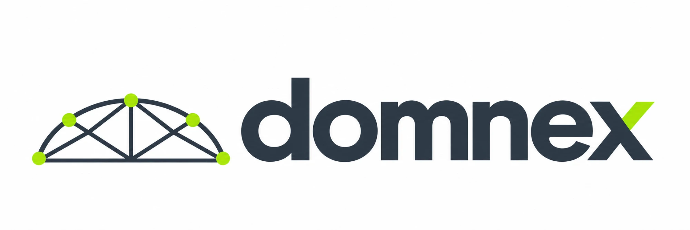

# domnex



**domnex** — gestão predial completa para condomínios: stacking plan
com o status de cada unidade (proprietário, inquilino, vago, comercialização, disputa),
cadastro de moradores e fluxo completo de comunicação de obra — abrangência, escopo,
cronograma de ruído, prestadores de serviço e assinatura digital com token.

Aplicação em HTML/CSS/JS puros, sem build. A camada de dados é isolada no
adaptador `Store` (`core.js`), que funciona em três modos, detectados sozinho:

1. **Servidor local** (`server.js`) — banco central em `data/db.json`; todos os
   navegadores que abrirem o endereço veem os mesmos dados e o link de
   comunicação de obra funciona entre navegadores diferentes.
2. **Banco do artifact** (quando publicado como artifact do Claude).
3. **localStorage** (demonstração: site estático, dados por navegador).

## Rodar com o servidor local (recomendado)

Sem nenhuma dependência para instalar — só o Node.js:

```bash
bash start.sh
```

E abra **http://localhost:8330**. Os dados ficam gravados em `data/db.json`
(fora do git). Para usar outra porta: `PORT=9000 bash start.sh`.

## Estrutura

| Arquivo | Papel |
|---|---|
| `index.html` | Casca da página |
| `styles.css` | Design system (temas claro/escuro) |
| `core.js` | Estado, modelo de domínio, adaptador de persistência, exportação (`condoworks/1`) |
| `views.js` | Painel do administrador (cadastro, stacking plan, obras) |
| `obra.js` | Formulário do morador, cronograma, documento para impressão, roteador |
